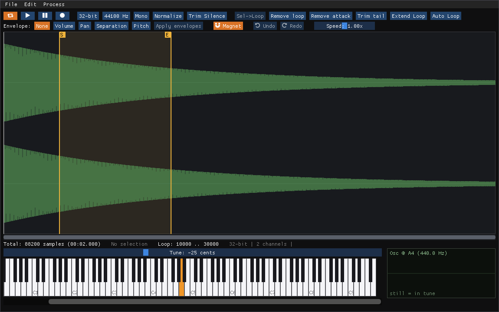

# NeoLooper

A sample-looping audio editor as a CLAP plugin (also available as VST3 and as a standalone app). It can also be used as a sound design tool.
Available on Linux and Windows (macOS is under consideration).

Tested on Reaper (Linux X11 and Windows); feedback is welcome.

On Linux the `.clap` doesn't bundle its runtime libraries (unlike Windows). If needed:

```sh
sudo apt install libsndfile1 librubberband2 libvorbisfile3
```



## Features

* Record from the DAW or import your sample in WAV, AIFF/AIF, FLAC, OGG and MP3 formats, from 16-bit and 24-bit up to 32-bit float.
* The edited sample is loaded in RAM. No disk is involved.
* Real-time preview.
* Piano included to test the sample in a sampler use case. Right-click to set the root note of the sample.
  * **Envelope** (under the piano): when enabled, the keys play through a simple amplitude envelope, Hold + Decay with sustain always 0, to hear how the sample behaves under a sampler's envelope while you shape its own amplitude curve. The decay curve can be *Linear*, *SF2* (FluidSynth: linear in dB down to -96 dB) or *SFZ (decay)* / *SFZ (release)* (sfizz: exponential, cut at -60 dB / -80 dB with a 50 ms fade). Preview only: the Play button and the sample itself are not affected.
* Slider to set the tune of the sample.
* Oscilloscope view to tune by eye instead of by ear; click to switch to spectrum view to see the frequencies.
* Recognizes MIDI root note, loop points and tune from supported formats (WAV/AIFF/FLAC).
* Supports OGG loop tags (LOOPSTART, LOOPLENGTH/LOOPEND) import and export.
* Supports "foreign data" chunks from FLAC at import and export.
* Envelope manipulation for Amplitude, Pan, Stereo and Pitch.
* Change sample rate, resample or even embed the tune in the sample rate of the sample.
* Buttons to normalize, trim silence, remove attack/tail of the sample, trim to the selection (Sel->Trim: keeps only the selected audio), and extend the loop.
* Change the speed of the playback with a slider (useful if you want to loop songs).
* Choose the playback interpolation next to the speed slider: *16 Sinc* (default, clean), *Cubic Spline* (4-point Catmull-Rom), *Linear* or *None* (drop-sample, like old hardware samplers). It only affects what you hear when the sample is repitched (piano, Tune, Speed); the sample and the export are untouched.

### Autoloop

Features an autoloop button that searches for possible loop points inside the sample. It includes three methods: milselarch (autolooper), Lars Palo (LoopAuditioneer) and Semicycle match, which splices right after zero crossings whose local waveform shape matches (Short mode: a fixed number of cycles; Long mode: any length within a range, refined sample by sample). Make a selection before running autoloop so it searches only within that zone. Useful for repeated waveforms like winds or synths.

### Process

You can process the sample with these methods:

* Reverse: reverse the sample/selected zone.
* Polarity: invert the polarity of the sample/selected zone (both channels, or only L/R on stereo samples).
* Filter: A high pass filter to remove low frequencies/DC offset and a high-shelf to boost (or cut) everything above a frequency, e.g. to enhance high frequencies.
* Amplitude: Modify the amplitude of the sample.
* Exciter: adds harmonics/brightness, a port of [M/S Exciter](https://github.com/KevinToodlepoot/MS-Exciter): an adjustable high-pass (2 kHz by default, as the original) driven through tube-like waveshapers at 2x oversampling (Drive, Bias, Exciter Mix), plus a Mid/Side stage (Width, Stereoize, M/S Mix). The result is level-matched to the original so applying it doesn't change the volume.
* Autotune: pitch correction powered by [Snaptune](https://github.com/NicoFerni/snaptune) (its Studio mode: TD-PSOLA, keeps the formants). Snaps the pitch to the nearest semitone, or to the sample's root note with **Use MIDI**; **Amount** sets how much of the pitch error is corrected; **Process for low notes** processes the sample an octave up and brings it back down, so notes below the detector's range (65 Hz, about C2) can be tuned too (down to ~33 Hz). A live graph shows how far the detected pitch is from its target note and where the correction leaves it.

### Pitch
Modify the pitch of the sample/selected zone.

* A built-in pitch changer that resamples or keeps the speed (a basic/inaccurate stretch implementation)
* A Signalsmith pitch changer implementation.
* A Loris Synthesis implementation.

### Stretch
Modify the speed of the sample/selected zone.

* A built-in basic/inaccurate stretch implementation
* A Rubber Band Library implementation.
* A Signalsmith Stretch implementation.

### Loop
The most important section of the plugin. Compiles every looping method possible.

Every loop method's window has a **Monitoring volume** slider (0 to +40 dB): it boosts only what you hear and the oscilloscope while the window is open, so quiet parts of a sample are easier to loop. It is never applied to the sample and starts at +0 dB every time a loop method is opened; while boosting, loud parts are clipped at 0 dBFS to protect your ears.

#### Classic Crossfade + (Inside)
The typical crossfade forward loop with an "Inside" variation. The difference between non-inside and inside is where it takes the crossfade portion (outside of the loop points or inside the loop points).

#### Ping Pong Classic
The first time this has been implemented in an audio loop editor. This is a special method used by old samplers/romplers from Roland and other obscure gear. Essentially, it's a loop that's designed to be played back in a ping-pong fashion, so the loop sounds much longer while only storing half the sample's loop information. The plugin automatically mirrors the loop to make it compatible with forward looping.

#### Ping Pong Crossfade + Inside
It's similar to Classic but this one creates a Crossfade after creating the mirror. This is obviously only compatible with forward looping.

#### Harmonic
It tries to keep the harmonics of the sample and create a seamless loop with them. Useful for Piano/keyboards with complex harmonic information. Change the FFT window size to get better/experimental results.

#### Ping Pong Harmonic
It uses the same algorithm to create a mirror of the same played frequencies (it's not a literal reverse effect of the sample). This is useful for solo strings and similar instruments/sounds. Easier than crossfade for this use case. Experiment with the FFT window size.

#### Freeze
As the name suggests, it "freezes" the frequencies to create a 1-cycle loop average of a specific position of the sample. It makes the process easier but with a small tune inconsistency due to the nature of the method. This can be improved by tuning the attack of the sample (Process -> Pitch) to match the tune of the loop. Experiment with the FFT window size. This is the easiest and most accurate approach for small/micro samples on cheap/low-memory gear from the 90s (SNES, Roland S-550, AKAI S2000, ...).

**Keep in mind to make this work correctly you have to set the right root note of the sample.**

Options: **Average** (exact cycle mode) builds the cycle from a section after the freeze point (every whole cycle in one FFT, each harmonic band's energy collapsed onto its exact harmonic with the original phase), so the frozen timbre is that section's average instead of a single FFT frame. **Auto phase** rotates the frozen chunk to the phase that best matches the attack before the freeze point; Offset adds a manual adjustment on top. **Loop gain** sets the frozen chunk's level by hand (dB over the level it comes out at), without touching the real attack; the crossfade blends into the new level. The entry crossfade isn't limited by Duration: even with the shortest (single-cycle) chunk, the chunk is repeated under the attack as many times as the fade needs, and the loop keeps its length. In exact cycle mode the length is set in **Loop cycles** instead of ms (its ms equivalent is shown next to it); more than one cycle makes the loop k cycles in round(k·period) samples instead of a whole-sample cycle, so the period's rounding is spread over the cycles: about 20 ms of loop keeps the tuning error under 1 cent at any note (one cycle can be off by several cents on high notes). 1 cycle still gives the single-cycle loop.

#### Freeze Stretch
This one uses Signalsmith with the lowest value of stretching to create an ethereal effect on the sample. Added for experimental sound design.

#### Rotation
This one takes a pre-looped sample (the loop must be free of clicks, unless **Make seamless first** is on) and creates layers of the same loop while changing the offset of each layer (the rotation effect). It can have from 2 to 100 layers and a generation seed.

**Make seamless first** (off by default) runs its Classic Crossfade (Inside) before rotating, so the loop being rotated is seamless and so is the result, with no extra crossfade afterward. With it off the marked loop is rotated as-is and must already be seamless. The summed layers are scaled to exactly the loop's own level per channel (the same whatever the seed or the number of layers) and keep the loop's DC instead of multiplying it. The attack is aligned with one rotation shared by both channels, keeping the stereo image; **Align channels separately** aligns each channel with its own attack instead.

#### Granular
Based on a Python script made by peastman in a VI-Control thread. It can extend a short sample (for example, staccato ones) and create a long loop with it.

#### Ensemble
Re-spreads each harmonic's energy around the exact harmonic, with random phases: a chorused, ensemble-like sustain. **Shape** sets how each harmonic is spread: *Gaussian* (a soft bell), *Flat* (an even band of the same width, denser) or *Voices* (N copies detuned in cents, a true unison, supersaw-like). Every shape uses two bands, below **Low frequency** and above **High frequency**, crossfaded in between: Low/High width set how wide each harmonic is for Gaussian/Flat (0 = pure harmonics), Low/High detune set the voices' spread in cents for Voices. **Band crossfade** shapes the transition between the two bands: *Curve* bends it one way (right = convex, it changes soon after Low frequency; left = concave/exponential, it changes late, near High frequency) and *Bipolar* makes an S (right = gentle near both bands and steep in the middle; left = steep near both bands with a plateau halfway); **Bend** 0 = linear. A live curve in the window shows both bands, the crossfade and where the loop's harmonics fall. **Inharmonicity** stretches the upper harmonics like a stiff string (piano-like at small values, bell/metallic at large ones) while the fundamental stays in tune. **Noise floor** adds the sample's own noise between the harmonics (breath, bow, hiss) with its real color, 100% = as loud as in the sample. Needs at least 10 cycles in the loop.

It rebuilds the marked loop from the whole cycles of the pitch that fit in it (the root note + Tune), matches its level to the original region (adjustable with **Loop gain**, in dB, without touching the attack) and splices it into the attack with the same entry crossfade as Harmonic (Crossfade/Curve, rotation aligned by correlation).

#### Ensemble (1 band)
Ensemble with the same options, but a single **Width** (or **Detune** for Voices) applied to the whole spectrum instead of the low and high bands.

#### Random Phase
Keeps the loop's magnitude spectrum and randomizes its phases (spectral phase randomization). With **Integer cycles** off it keeps the marked region's exact length and needs no pitch, useful for noise, ambiences and inharmonic sounds. **Amount** sets how much of each frequency's phase is randomized (100% = a fully stationary texture; lower keeps part of the region's own movement; 0% = the region as-is). **Stereo decorrelation** gives each channel its own random phases for a wider image (or pseudo-stereo from a mono source). **Smoothing** averages the frozen spectrum over a bandwidth in Hz, removing the spiky, metallic color a single long analysis gives noise; keep it well below the fundamental on pitched sounds. Same **Loop gain** and entry crossfade as Ensemble.

## Build (Linux)

Dependencies: CMake ≥ 3.16, a C++20 compiler, `libsndfile1-dev`,
`libx11-dev`, `libgl1-mesa-dev`, `librubberband-dev` (pulls in
`libfftw3-dev` and `libsamplerate0-dev`). CLAP, Dear ImGui, Loris,
Signalsmith Stretch and Snaptune's DSP (no JUCE needed, see
`third_party/snaptune/VENDORED_FROM.txt`) are vendored under `third_party/`; Rubber Band links
against the system library via pkg-config.

```sh
cmake -B build -DCMAKE_BUILD_TYPE=Release
cmake --build build
cp build/NeoLooper.clap ~/.clap/
cp -r build/NeoLooper.vst3 ~/.vst3/
```

The build also produces, through
[clap-wrapper](https://github.com/free-audio/clap-wrapper), each in one
self-contained binary (neither needs the `.clap` installed):

* a **VST3**, `build/NeoLooper.vst3`;
* a **standalone** app, `build/NeoLooper`: NeoLooper in its own window, no DAW
  needed. **File > Audio Settings...** (only shown in the standalone) opens the
  audio setup: audio API (PipeWire or JACK on Linux, loaded at run time;
  WASAPI on Windows), input/output devices and channels, sample rate and
  buffer size. In the standalone the input isn't passed through to the output
  (a microphone would feed back through the speakers); recording from the
  input works as usual.

Configuring downloads clap-wrapper and the VST3 SDK (both MIT). Pass
`-DVST3_SDK_ROOT=<path>` to use a local SDK, and `-DNEOLOOPER_BUILD_VST3=OFF`
/ `-DNEOLOOPER_BUILD_STANDALONE=OFF` to skip either (both off: CLAP only, no
download). The standalone's PipeWire/JACK support needs their headers at build
time (`libpipewire-0.3-dev`, `libjack-jackd2-dev`).

The editor draws with OpenGL (GLX) when it gets a direct (local) OpenGL
context. Otherwise - typically remote X sessions (ssh -X, VNC, xrdp, X2Go,
VcXsrv/Xming), which offer no GLX or only indirect GLX, and whenever
`LIBGL_ALWAYS_INDIRECT` is set - it is drawn in software instead
(`src/gui/imgui_soft_renderer.cpp`, sent with `XPutImage`, only the part
that changed, at up to 30 fps); the reason is printed on stderr.
`NEOLOOPER_SOFTWARE_RENDER=1` in the DAW's environment forces it.

### Tests

```sh
./build/core_test /tmp                        # offline core + RT engine checks
./build/mini_host build/NeoLooper.clap         # headless smoke test
./build/mini_host build/NeoLooper.clap gui     # + a real 4s GUI window
./build/alt_loop_test                         # extra loop methods (Ensemble, Random Phase, Freeze/Rotation options)
```

## Build (Windows)

Dependencies: CMake ≥ 3.16, MSVC (Visual Studio 2022 Build Tools, "Desktop
development with C++" workload), and [vcpkg](https://github.com/microsoft/vcpkg)
for `libsndfile` and `rubberband` (pulls in `fftw3`/`libsamplerate`). CLAP,
Dear ImGui (including the Win32 backend, `third_party/imgui/backends/imgui_impl_win32.*`),
Loris/Signalsmith Stretch, Snaptune and dr_mp3 (MP3 import, see Features above) are
vendored the same way as on Linux.

```powershell
git clone https://github.com/microsoft/vcpkg C:\vcpkg
C:\vcpkg\bootstrap-vcpkg.bat
C:\vcpkg\vcpkg.exe install "libsndfile[core,external-libs]" rubberband --triplet x64-windows
```

`libsndfile`'s default features include an MPEG (MP3) codec via `mp3lame`/
`mpg123` -- explicitly excluded above (`[core,external-libs]` instead of the
default `[core,external-libs,mpeg]`) because NeoLooper never uses it (MP3
import goes through the vendored dr_mp3 instead) and because a DAW that
already bundles its own, differently-built `libmp3lame.dll`/`mpg123.dll`
(REAPER does, under its own `Plugins\` folder) can otherwise end up
resolving *our* `sndfile.dll`'s implicit import of those names to *its*
copy instead, which surfaces as a spurious "ordinal not found" error the
first time any audio file is opened. See `src/win_delayload.cpp` for the
underlying issue this also guards against more generally.

Then, from a **Developer Command Prompt/PowerShell for VS 2022** (needed for
`cl.exe`):

```powershell
cmake -B build -G Ninja -DCMAKE_BUILD_TYPE=Release `
  -DCMAKE_TOOLCHAIN_FILE=C:\vcpkg\scripts\buildsystems\vcpkg.cmake `
  -DVCPKG_TARGET_TRIPLET=x64-windows
cmake --build build
```

`NeoLooper.clap` (a PE DLL despite the extension) and its vcpkg-provided
runtime DLLs (`sndfile.dll` deployed a second time as `neolooper_sndfile.dll`,
`rubberband-*.dll`, `FLAC.dll`, `ogg.dll`, `vorbis*.dll`, `opus.dll`,
`samplerate.dll`, `sleef*.dll`) land side by side in `build\`; copy the
whole set to wherever your host looks for CLAP plugins (e.g.
`%COMMONPROGRAMFILES%\CLAP` for all users, or
`%LOCALAPPDATA%\Programs\Common\CLAP` per-user), since those DLLs aren't
statically linked in. The plain `sndfile.dll` copy is a build byproduct and
isn't actually used at runtime (see below) -- harmless to leave out.

`sndfile.dll`/`rubberband-3.dll` are `/DELAYLOAD`-ed rather than linked
normally, and `src/win_delayload.cpp` resolves them (and `sndfile.dll`'s own
further dependencies) by an absolute path next to `NeoLooper.clap` itself
at first use: a host process has no reason to add a plugin's own directory
to its DLL search path, so a plain dynamic link would leave those DLLs
unfindable the moment the plugin is loaded from anywhere other than a
same-folder test harness. `sndfile.dll` is additionally deployed under the
plugin-private name `neolooper_sndfile.dll` (redirected to by that same
hook) since "sndfile.dll" is a common enough name that another already-
loaded component in the host process could collide with it.

### Tests

```powershell
build\core_test.exe %TEMP%
build\mini_host.exe build\NeoLooper.clap
build\mini_host.exe build\NeoLooper.clap gui
```

Also verified end-to-end inside REAPER on Windows: plugin scan/insert,
opening/closing the editor, importing WAV/MP3, and recording/loop
processing from the DAW.

## Status

Tested on Linux (X11) and, as of this writing, verified end-to-end on
Windows (Win32/WGL) inside REAPER: scan/insert, opening and closing the
plugin editor, importing audio (including MP3), and recording/loop
processing from the DAW. macOS is unported. The platform-specific surface
is small: `gui/gui_window_x11.cpp` / `gui/gui_window_win32.cpp` (X11/GLX/
XDND vs. Win32/WGL/`WM_DROPFILES`, sharing the public API in
`gui/gui_window.hpp`), `src/win_delayload.cpp` (Windows-only, resolves the
delay-loaded sndfile/rubberband DLLs by absolute path -- see Build
(Windows) above), the CLAP window API selection in `plugin.cpp`
(`CLAP_WINDOW_API_X11` vs. `_WIN32`), and a couple of one-line differences
in `gui/file_dialog.cpp` (home directory, case-insensitive sort). Porting
to macOS would mean adding a `gui_window_cocoa.mm` alongside the X11/Win32
pair.

## Credits

See [special_thanks.txt](special_thanks.txt) for the third-party algorithms
and libraries this project builds on.

## Note for transparency

I need to say this: I'm not a C++ programmer and I did this with the help of Claude. This was designed based on years of experience manipulating samples and mixing the right ingredients for a one solution tool for this task. Everything specified here was made based on being practical and useful. You're free to not use it if you don't like the way it was created. And for those who are grateful, thank you and I'll try my best to make it work on more platforms. 
