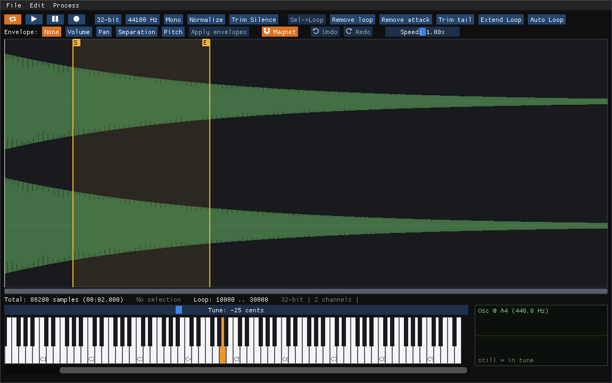

# NeoLooper

A sample-looping audio editor as a CLAP plugin. It can also be used as a sound design tool.
Available on Linux and Windows (macOS is under consideration).

Tested on Reaper (Linux X11 and Windows); feedback is welcome.

On Linux the `.clap` doesn't bundle its runtime libraries (unlike Windows). If needed:

```sh
sudo apt install libsndfile1 librubberband2 libvorbisfile3
```



## Features

* Record from the DAW or import your sample in WAV, AIFF/AIF, FLAC, OGG and MP3 formats, from 16-bit and 24-bit up to 32-bit float.
* The edited sample is loaded in RAM. No disk is involved.
* Real-time preview.
* Piano included to test the sample in a sampler use case. Right-click to set the root note of the sample.
* Slider to set the tune of the sample.
* Oscilloscope view to tune by eye instead of by ear; click to switch to spectrum view to see the frequencies.
* Recognizes MIDI root note, loop points and tune from supported formats (WAV/AIFF/FLAC).
* Supports OGG loop tags (LOOPSTART, LOOPLENGTH/LOOPEND) import and export.
* Supports "foreign data" chunks from FLAC at import and export.
* Envelope manipulation for Amplitude, Pan, Stereo and Pitch.
* Change sample rate, resample or even embed the tune in the sample rate of the sample.
* Buttons to normalize, trim silence, remove attack/tail of the sample, and extend the loop.
* Change the speed of the playback with a slider (useful if you want to loop songs).

### Autoloop

Features an autoloop button that searches for possible loop points inside the sample. It includes three methods: milselarch (autolooper), Lars Palo (LoopAuditioneer) and Semicycle match, which splices right after zero crossings whose local waveform shape matches (Short mode: a fixed number of cycles; Long mode: any length within a range, refined sample by sample). Make a selection before running autoloop so it searches only within that zone. Useful for repeated waveforms like winds or synths.

### Process

You can process the sample with these methods:

* Reverse: reverse the sample/selected zone.
* Polarity: invert the polarity of the sample/selected zone (both channels, or only L/R on stereo samples).
* Filter: A high pass filter to remove low frequencies/DC offset and a band filter to enhance high frequencies.
* Amplitude: Modify the amplitude of the sample.

### Pitch
Modify the pitch of the sample/selected zone.

* A built-in pitch changer that resamples or keeps the speed (a basic/inaccurate stretch implementation)
* A Signalsmith pitch changer implementation.
* A Loris Synthesis implementation.

### Stretch
Modify the speed of the sample/selected zone.

* A built-in basic/inaccurate stretch implementation
* A Rubber Band Library implementation.
* A Signalsmith Stretch implementation.

### Loop
The most important section of the plugin. Compiles every looping method possible.

#### Classic Crossfade + (Inside)
The typical crossfade forward loop with an "Inside" variation. The difference between non-inside and inside is where it takes the crossfade portion (outside of the loop points or inside the loop points).

#### Ping Pong Classic
The first time this has been implemented in an audio loop editor. This is a special method used by old samplers/romplers from Roland and other obscure gear. Essentially, it's a loop that's designed to be played back in a ping-pong fashion, so the loop sounds much longer while only storing half the sample's loop information. The plugin automatically mirrors the loop to make it compatible with forward looping.

#### Ping Pong Crossfade + Inside
It's similar to Classic but this one creates a Crossfade after creating the mirror. This is obviously only compatible with forward looping.

#### Harmonic
It tries to keep the harmonics of the sample and create a seamless loop with them. Useful for Piano/keyboards with complex harmonic information. Change the FFT window size to get better/experimental results.

#### Ping Pong Harmonic
It uses the same algorithm to create a mirror of the same played frequencies (it's not a literal reverse effect of the sample). This is useful for solo strings and similar instruments/sounds. Easier than crossfade for this use case. Experiment with the FFT window size.

#### Freeze
As the name suggests, it "freezes" the frequencies to create a 1-cycle loop average of a specific position of the sample. It makes the process easier but with a small tune inconsistency due to the nature of the method. This can be improved by tuning the attack of the sample (Process -> Pitch) to match the tune of the loop. Experiment with the FFT window size. This is the easiest and most accurate approach for small/micro samples on cheap/low-memory gear from the 90s (SNES, Roland S-550, AKAI S2000, ...).

**Keep in mind to make this work correctly you have to set the right root note of the sample.**

#### Freeze Stretch
This one uses Signalsmith with the lowest value of stretching to create an ethereal effect on the sample. Added for experimental sound design.

#### Rotation
This one takes a pre-looped sample (the loop must be free of clicks) and creates layers of the same loop while changing the offset of each layer (the rotation effect). It can have from 2 to 100 layers and a generation seed.

#### Granular
Based on a Python script made by peastman in a VI-Control thread. It can extend a short sample (for example, staccato ones) and create a long loop with it.

## Build (Linux)

Dependencies: CMake ≥ 3.16, a C++20 compiler, `libsndfile1-dev`,
`libx11-dev`, `libgl1-mesa-dev`, `librubberband-dev` (pulls in
`libfftw3-dev` and `libsamplerate0-dev`). CLAP, Dear ImGui, Loris and
Signalsmith Stretch are vendored under `third_party/`; Rubber Band links
against the system library via pkg-config.

```sh
cmake -B build -DCMAKE_BUILD_TYPE=Release
cmake --build build
cp build/NeoLooper.clap ~/.clap/
```

### Tests

```sh
./build/core_test /tmp                        # offline core + RT engine checks
./build/mini_host build/NeoLooper.clap         # headless smoke test
./build/mini_host build/NeoLooper.clap gui     # + a real 4s GUI window
```

## Build (Windows)

Dependencies: CMake ≥ 3.16, MSVC (Visual Studio 2022 Build Tools, "Desktop
development with C++" workload), and [vcpkg](https://github.com/microsoft/vcpkg)
for `libsndfile` and `rubberband` (pulls in `fftw3`/`libsamplerate`). CLAP,
Dear ImGui (including the Win32 backend, `third_party/imgui/backends/imgui_impl_win32.*`),
Loris/Signalsmith Stretch and dr_mp3 (MP3 import, see Features above) are
vendored the same way as on Linux.

```powershell
git clone https://github.com/microsoft/vcpkg C:\vcpkg
C:\vcpkg\bootstrap-vcpkg.bat
C:\vcpkg\vcpkg.exe install "libsndfile[core,external-libs]" rubberband --triplet x64-windows
```

`libsndfile`'s default features include an MPEG (MP3) codec via `mp3lame`/
`mpg123` -- explicitly excluded above (`[core,external-libs]` instead of the
default `[core,external-libs,mpeg]`) because NeoLooper never uses it (MP3
import goes through the vendored dr_mp3 instead) and because a DAW that
already bundles its own, differently-built `libmp3lame.dll`/`mpg123.dll`
(REAPER does, under its own `Plugins\` folder) can otherwise end up
resolving *our* `sndfile.dll`'s implicit import of those names to *its*
copy instead, which surfaces as a spurious "ordinal not found" error the
first time any audio file is opened. See `src/win_delayload.cpp` for the
underlying issue this also guards against more generally.

Then, from a **Developer Command Prompt/PowerShell for VS 2022** (needed for
`cl.exe`):

```powershell
cmake -B build -G Ninja -DCMAKE_BUILD_TYPE=Release `
  -DCMAKE_TOOLCHAIN_FILE=C:\vcpkg\scripts\buildsystems\vcpkg.cmake `
  -DVCPKG_TARGET_TRIPLET=x64-windows
cmake --build build
```

`NeoLooper.clap` (a PE DLL despite the extension) and its vcpkg-provided
runtime DLLs (`sndfile.dll` deployed a second time as `neolooper_sndfile.dll`,
`rubberband-*.dll`, `FLAC.dll`, `ogg.dll`, `vorbis*.dll`, `opus.dll`,
`samplerate.dll`, `sleef*.dll`) land side by side in `build\`; copy the
whole set to wherever your host looks for CLAP plugins (e.g.
`%COMMONPROGRAMFILES%\CLAP` for all users, or
`%LOCALAPPDATA%\Programs\Common\CLAP` per-user), since those DLLs aren't
statically linked in. The plain `sndfile.dll` copy is a build byproduct and
isn't actually used at runtime (see below) -- harmless to leave out.

`sndfile.dll`/`rubberband-3.dll` are `/DELAYLOAD`-ed rather than linked
normally, and `src/win_delayload.cpp` resolves them (and `sndfile.dll`'s own
further dependencies) by an absolute path next to `NeoLooper.clap` itself
at first use: a host process has no reason to add a plugin's own directory
to its DLL search path, so a plain dynamic link would leave those DLLs
unfindable the moment the plugin is loaded from anywhere other than a
same-folder test harness. `sndfile.dll` is additionally deployed under the
plugin-private name `neolooper_sndfile.dll` (redirected to by that same
hook) since "sndfile.dll" is a common enough name that another already-
loaded component in the host process could collide with it.

### Tests

```powershell
build\core_test.exe %TEMP%
build\mini_host.exe build\NeoLooper.clap
build\mini_host.exe build\NeoLooper.clap gui
```

Also verified end-to-end inside REAPER on Windows: plugin scan/insert,
opening/closing the editor, importing WAV/MP3, and recording/loop
processing from the DAW.

## Status

Tested on Linux (X11) and, as of this writing, verified end-to-end on
Windows (Win32/WGL) inside REAPER: scan/insert, opening and closing the
plugin editor, importing audio (including MP3), and recording/loop
processing from the DAW. macOS is unported. The platform-specific surface
is small: `gui/gui_window_x11.cpp` / `gui/gui_window_win32.cpp` (X11/GLX/
XDND vs. Win32/WGL/`WM_DROPFILES`, sharing the public API in
`gui/gui_window.hpp`), `src/win_delayload.cpp` (Windows-only, resolves the
delay-loaded sndfile/rubberband DLLs by absolute path -- see Build
(Windows) above), the CLAP window API selection in `plugin.cpp`
(`CLAP_WINDOW_API_X11` vs. `_WIN32`), and a couple of one-line differences
in `gui/file_dialog.cpp` (home directory, case-insensitive sort). Porting
to macOS would mean adding a `gui_window_cocoa.mm` alongside the X11/Win32
pair.

## Credits

See [special_thanks.txt](special_thanks.txt) for the third-party algorithms
and libraries this project builds on.

## Note for transparency

I need to say this: I'm not a C++ programmer and I did this with the help of Claude. This was designed based on years of experience manipulating samples and mixing the right ingredients for a one solution tool for this task. Everything specified here was made based on being practical and useful. You're free to not use it if you don't like the way it was created. And for those who are grateful, thank you and I'll try my best to make it work on more platforms. 
